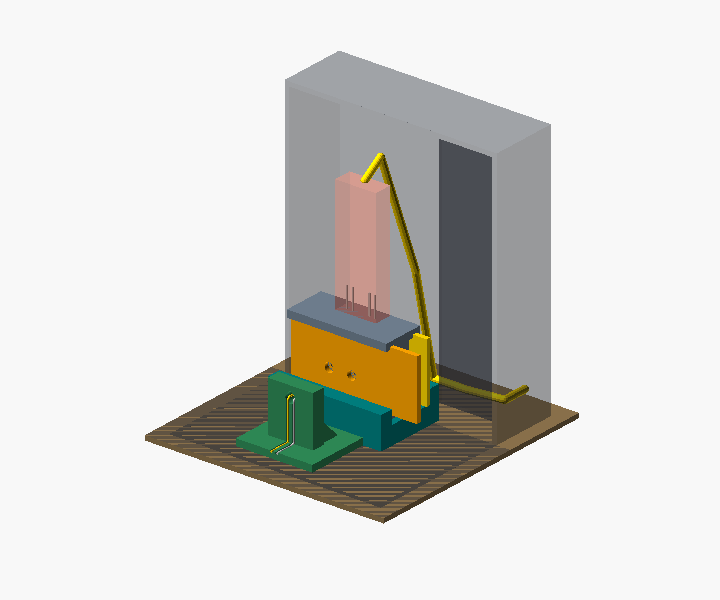

# Quantyra optical fixture system

Editable OpenSCAD, exact supplied STL meshes and original machine-specific G-code for a light-source stand, dual V11 photodiode-jig cradle and independent lift-off ambient-light hood. Packaging **v1.0.0**; all dimensions in millimetres.

Start with the [print and assembly guide](docs/print-and-assembly.md). Prefer the **34 mm stand** for visual edge registration to either port of the fixed dual jig body. The **32 mm stand** is a supported narrow option, dimensionally consistent with the supplied stand G-code; it needs measured lateral alignment.

| Printable part | Editable source / selector | Exact supplied mesh | Dimensions / print orientation |
| --- | --- | --- | --- |
| Preferred stand | [34 mm SCAD](cad/fixed_ir_source_34mm.scad), `part="source_stand"` | [34 mm STL](stl/source_stand_34mm.stl) | 34 x 28 x 25; foot-down |
| Narrow stand | [32 mm SCAD](cad/fixed_ir_source_32mm.scad), `part="source_stand"` | [32 mm STL](stl/source_stand_32mm.stl) | 32 x 28 x 25; foot-down |
| Dual V11 cradle | Either stand SCAD, `part="detector_cradle"` | [Cradle STL](stl/detector_cradle.stl) | 50 x 32 x 14; flat base-down |
| Hood | [Hood SCAD](cad/ambient_cover.scad), `mode="print"` | [Roof-down STL](stl/ambient_cover_110mm_roof_down.stl) | 94 x 94 x 112 outer; closed roof-down |

Only those selectors produce printable parts. Stand selectors `assembly`, `source_route`, `section`, `entry` and hood modes `assembly`, `cutaway` are illustrations or sections with proxy hardware. They are not additional printable parts. Sources are self-contained; comment sanitization leaves modeling statements unchanged. Supplied STL and G-code bytes are unchanged.

[G-code notes](gcode/README.md) and the [profile/hash manifest](gcode/manifest.json) cover three original files. Exact source slicing is **not established**. Supplied stand G-code has a 32 mm footprint and does not match the preferred 34 mm stand. Prefer re-slicing your intended STL for your exact printer, firmware and material.

The cradle targets the **dual V11 fixed body**; single-port compatibility is unverified. Obtain the jig, shutter, drawer, circuit and separately AGPL-licensed Arduino code from [Quantyra photodiode-jig](https://github.com/Quantyra/photodiode-jig).

The user reports that the hood seems to print well after correcting the material profile to PETG. This is a print observation, not completed fit, leakage or commissioning evidence. The widened 34 mm stand remains physically unverified. No hardware testing was performed for this package. Complete physical commissioning remains bench work. Locking, exclusive illumination, opacity, extinction, repeatability and laser safety are not certified. Patent pending.

Hardware/source, meshes, G-code and documentation use [CERN-OHL-S-2.0](LICENSE). Source Location: https://github.com/Quantyra/optical-fixture-system. Read the [plain-language license guide](docs/licensing.md). Open-source questions: info@quantyra.org. Separate non-copyleft commercial terms: info@qxcellerate.com.

[File manifest](manifest.json), [SHA-256 checksums](SHA256SUMS), [CITATION.cff](CITATION.cff) and [.zenodo.json](.zenodo.json) identify this package. No DOI is assigned here. Run `python scripts/validate_release.py` for integrity, basic mesh and metadata checks. Cite the version, exact public commit, stand size and paths used.
