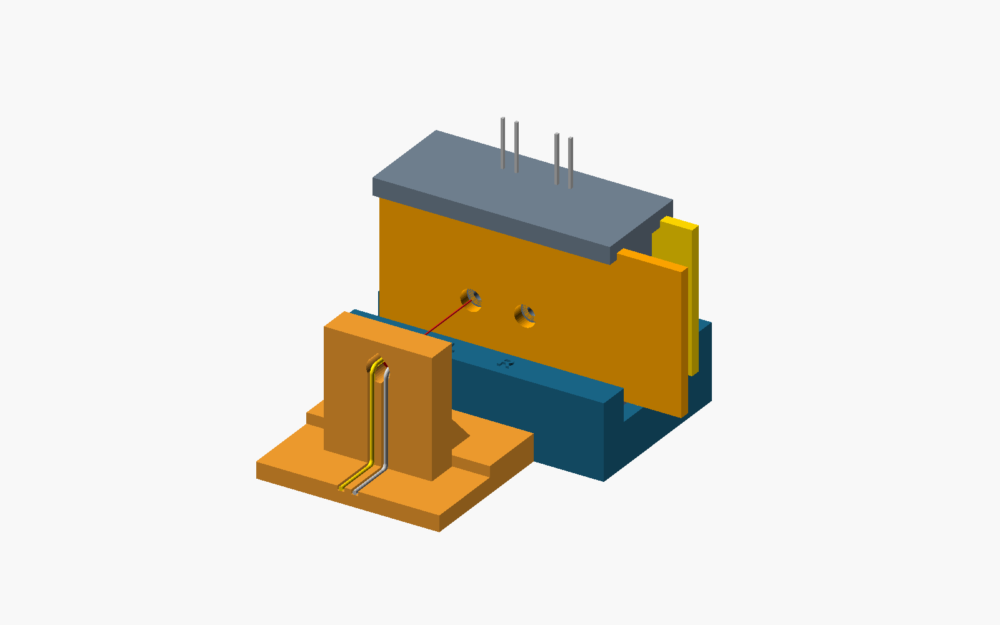

# Quantyra optical fixture system

**v1.1.0** adds the recommended keyed source stand and dual-port cradle. The detector jig V11 itself is unchanged. Editable OpenSCAD, exact approved STLs, original operator-supplied G-code and preserved legacy parts are included. Dimensions are millimetres. Patent pending.

| Current part | Editable CAD selector | Exact mesh | Print orientation |
| --- | --- | --- | --- |
| Keyed source stand | [keyed_fixture.scad](cad/keyed_fixture.scad), `part="stand"` | [STL](stl/source_stand_female.stl) | Foot down |
| Two-port male cradle | Same CAD, `part="cradle"` | [STL](stl/detector_cradle_two_male_ports.stl) | Sole down |

The operator physically printed the revised stand and reports that the stand and jig fit. This is practical user fit evidence, with no measured precision, optical performance or machine qualification claim. CAD compatibility with the [25/50/100 mm spacers](https://github.com/Quantyra/optical-path-spacers) passed; physical extension fit remains untested.

Read the [assembly and printing guide](docs/print-and-assembly.md), [G-code notes](gcode/README.md) and [geometry checks](docs/geometry-checks.json). The source-facing L/R positions are 10 mm apart. Withdraw 7.2 mm straight before moving sideways. Joint clearance does not provide clamping or perfect alignment.

Legacy 34 mm and 32 mm stands, original cradle and original lift-off hood remain unchanged in `cad/` and `stl/`; their original G-code and previews are retained. They are historical alternatives, not interchangeable keyed components. The original hood is incompatible with the extended rig; no hood redesign is released. See [legacy parts](docs/legacy-parts.md).

Obtain the unchanged dual V11 jig, shutters, drawer and separately AGPL-licensed electronics code from [Quantyra photodiode-jig](https://github.com/Quantyra/photodiode-jig). Preview hardware uses unmeasured proxies; the red line illustrates an axis, not a measured beam.

Hardware/source, meshes, G-code and documentation use [CERN-OHL-S-2.0](LICENSE). [Attribution](ATTRIBUTION.md), [licensing guide](docs/licensing.md). Source Location: https://github.com/Quantyra/optical-fixture-system. Open-source questions: info@quantyra.org. Separate commercial terms: info@qxcellerate.com.

Run `python scripts/validate_release.py` for focused offline integrity, privacy, local-link, metadata and mesh checks. [Manifest](manifest.json), [SHA-256 checksums](SHA256SUMS), [citation](CITATION.cff), [Zenodo metadata](.zenodo.json).

Concept DOI: [10.5281/zenodo.23484827](https://doi.org/10.5281/zenodo.23484827). **v1.1.0 version DOI pending publication**. Historical v1.0.1: [10.5281/zenodo.23485390](https://doi.org/10.5281/zenodo.23485390). Previous tags and archives are unchanged.
