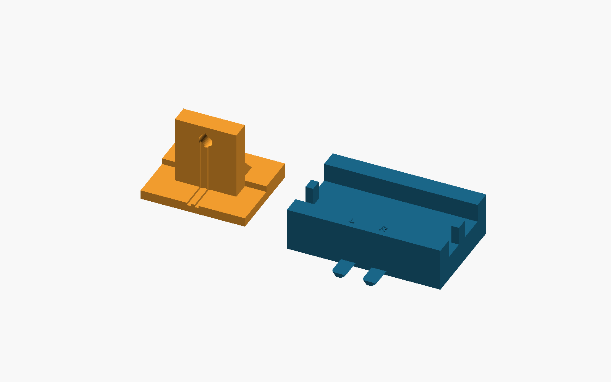

# Keyed pair: printing and assembly

Use `source_stand_female.stl` with `detector_cradle_two_male_ports.stl`. This cradle carries the existing dual V11 jig; it is not a new detector holder. Use `cad/keyed_fixture.scad`, `part="stand"` or `part="cradle"` to export. `assembly`, `print`, `underside` and `detail` are illustrations, not extra print parts. All CAD imports resolve within this package.

Print both flat, sole/foot down. Re-slice the exact STLs for your printer and material; inspect layers, dovetail flanks, tongue roots, pocket mouths and roof bridges. Avoid supports trapped in the sole-open pockets. Check the 8 mm relief bridges and 3 mm stand roof in the slicer. Keep the whole sole flat; remove debris without altering the datums. Fit gently before mounting hardware. Do not force or use thin tongues as handles. Reject warped, cracked or rocking parts.

The revised front apron is 5 mm thick; pocket ceiling Z=2 mm, male tongue height 1.4 mm, stand roof 3 mm. Seated roof gap is 0.6 mm and horizontal side clearance is 0.25 mm per flank. The source seat and nominal optical axis height Z=20 mm are preserved. The 0.6 mm roof gap is not free lift: in the ideal centered straight section, sloped flanks govern about 0.35 mm relative lift, with `abs(dx) + lift/1.4 <= 0.25` before flank contact. Tilt, yaw, printed tolerances and partially withdrawn tips require separate checks. This is a clearance joint without latch, clamp or preload.

1. Keep the cradle fixed on a firm flat bench. Install the unchanged V11 jig using its original instructions; leave source lead slack.
2. Looking **from source toward detector**, L is world X=-5 mm and R is X=+5 mm. These are positions, not electrical polarity. Align the stand's central captured socket with the selected cradle tongue; the corresponding loose outer relief clears the unused tongue.
3. Keep both soles flat and slide the stand toward the jig (+Y) until broad stop faces seat squarely. Check seating, rocking and lead clearance by hand.
4. To switch ports, brace the cradle, withdraw the stand **7.2 mm straight toward the source (-Y)**, move **10 mm laterally**, then reinsert. Do not move sideways while engaged or lift to switch.

The operator printed the revised stand and confirms stand/jig fit. No measured repeatability, precision or optical result is established. Check real source/detector positions and alignment at the bench; proxy previews cannot certify them.

For added distance use the separately packaged [optical path spacers](https://github.com/Quantyra/optical-path-spacers). CAD compatibility passed with this stand; physical extension fit is untested. The original lift-off hood collides with the extended rig. Use independent ambient control, such as a suitably sized opaque enclosure around the entire supported rig, with clearances for travel and leads. Check mechanical clearance and measure dark/background response before use; no enclosure fit or light-leak performance is promised. For the direct keyed pair, check the retained hood's clearance and full withdrawal travel independently as well.

Original machine-specific G-code is supplied as provenance, not a portable print recipe. Inspect [G-code notes](../gcode/README.md). No G-code was executed for this release.

For matching raised lettering, use OpenSCAD with Liberation Sans Bold available. The supplied exact STLs remain the print reference if another font environment changes text outlines. CAD export equality here was checked in the release build environment; no fonts or slicer are installed by the validator.
