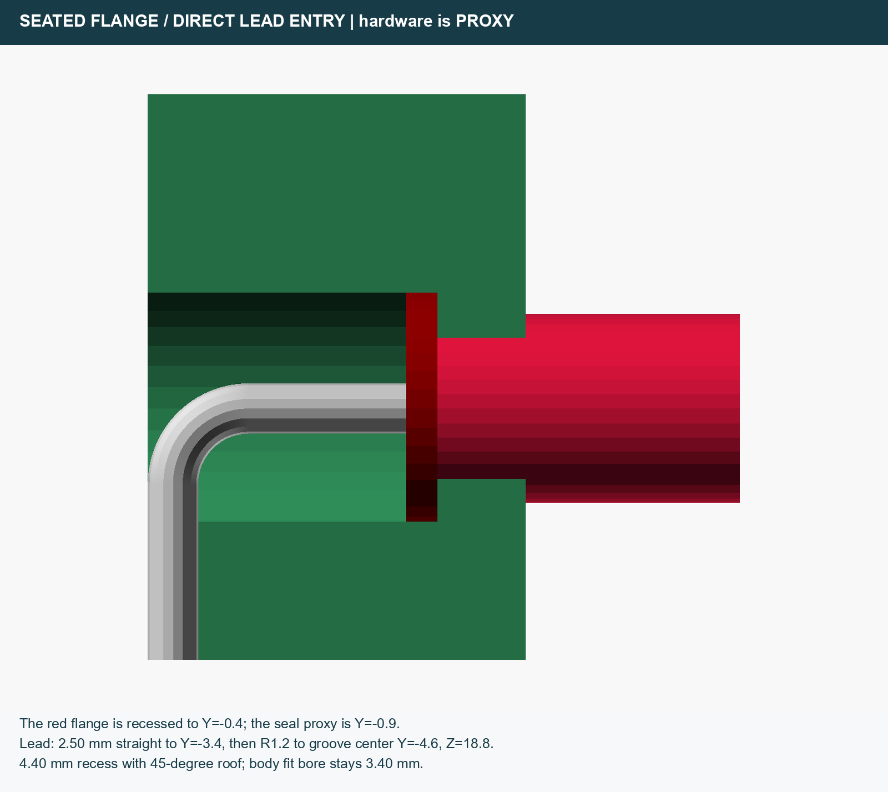
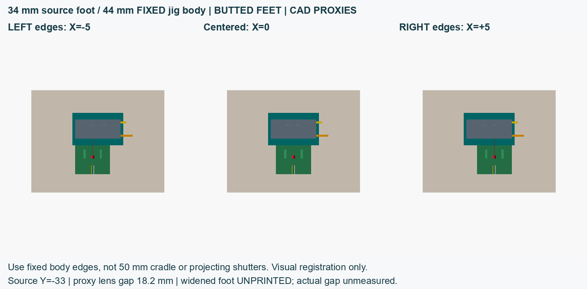

# Print and assembly

## Choose and slice

Prefer the 34 mm stand for dual-port edge alignment. The supported 32 mm stand matches the approximate size of the supplied stand G-code. Its edge against a 44 mm body yields a 6 mm center offset, not the required 5 mm: measure its lateral position instead.

Slice at 100% scale in millimetres. PETG, a 0.4 mm nozzle, 0.2 mm layers and a 5 mm brim are starting guidance, not validated manufacturing settings. Select temperatures and speeds for your actual material and machine. Dark filament does not establish optical opacity. Inspect layer previews for the seat, grooves, walls and cable route.

- Stand: broad foot-down, upright vertical.
- Cradle: flat base-down, retaining walls upward.
- Hood: supplied STL is closed roof-down, open rim-up. Keep this orientation so the roof prints on the bed and walls/baffle grow upward. The supplied profile disables support; inspect your own slice.

The original G-code has its own [actual profile values](../gcode/README.md). Re-slice the 34 mm STL; no supplied G-code matches it.

## Source and leads

Measure the actual body, flange, lead diameter/pitch, straight lead allowance and terminal hardware before assembly. Nominal CAD values are a 3.4 mm bore, 4.4 mm rear-loading recess, 1.4 mm seat land, 2.54 mm lead pitch, 1.3 mm independent grooves and 0.8 mm groove depth. These are design values, not measured hardware dimensions.

Load the flange from the rear against the recessed seat. The lead paths have open entry into the recess and independent wall-to-base grooves. Their CAD junction is square. Illustrative conductors use relaxed bends; they are neither forming tools nor hardware bend-radius specifications. Support each lead away from the package seal while forming it gently, preserving the straight length required by the actual device. Do not pull the seal, force the flange or assume proxy polarity. Use insulated terminals and strain relief; keep exposed conductors apart. Stop if measured hardware cannot fit without force.

## Seat and align the dual jig

Follow the dual V11 jig's own guide in the linked repository. Rotate it into the cradle with **leads upward**. The modeled aperture height is 20 mm: 8 mm cradle floor plus 12 mm transformed aperture offset, matching the source axis. Body datum tabs have nominal clearance and do not clamp. Check seating and shutter/drawer corridors without forcing parts. Single-port compatibility is unverified.

Butt the stand and cradle feet. In assembly coordinates source Y=-33 places its forward edge at cradle Y=-19. The resulting **18.2 mm lens gap is modeled using proxy hardware, not measured**. Measure actual spacing after assembly.

The fixed dual body is 44 mm wide with 10 mm port pitch. A 34 mm stand centered at X=0 lies between ports. Align corresponding **left fixed-body and stand edges** for X=-5 mm; corresponding **right edges** give X=+5 mm. Reference the fixed body, not the 50 mm cradle or moving panels. Visual registration provides no detent, locking, exclusive illumination or repeatability guarantee. Confirm channel identity and alignment experimentally. After alignment, fix both feet to a rigid opaque support without distortion or obstructing panels/wires.

## Independent hood

Nominal clear space is 90 x 90 x 110 mm; outer size is 94 x 94 x 112 mm. The independent open-bottom hood lifts off and has an internal baffle with an offset cable exit. Its illustrative assembly offset is X=6, Y=-7 mm. Route wires around the baffle and through the exit without strain, pinching, sharp bends or exposed shorts.

The provisional height budget is 38 + 10 + 40 = 88 mm, leaving 22 mm to the 110 mm ceiling. Measure actual terminals and relaxed wires; this is not verified clearance.

**Lift the hood before shutter changes or full panel withdrawal. Keep hands outside while it is lowered.** It is not a clamp, handle or safety enclosure.

## Bench commissioning

Check dimensions, seating, lead strain, insulation, panel travel, optical heights and actual spacing. Check alignment with the hood lifted, then verify clearance while lowering it. Measure source-off baseline, each shutter state, ambient/seam/cable-exit leakage and repeat/removal behavior with your actual materials and source. No completed fit, light-exclusion, extinction, locking, exclusive illumination, opacity, repeatability or laser-safety certification is asserted. Assess the actual optical source and electrical setup before operation.
